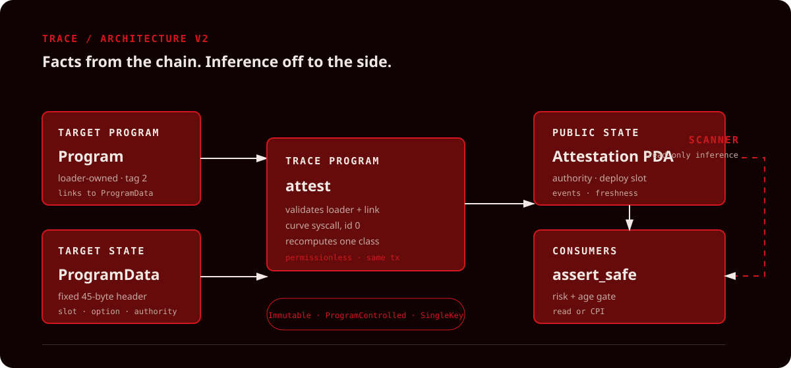

# Trace

> A trustless on-chain registry of Solana program upgrade-authority risk: immutable, program-controlled, or a single key.

Trace answers one narrow security question: **who can change this Solana
program's code?** Its Anchor program recomputes the answer from loader-owned
accounts in the same transaction, stores a public attestation, and exposes an
`assert_safe` gate that another program can call.



## What Trace is

Trace is an on-chain risk registry for Solana programs. Its Anchor program
recomputes a target's upgrade-authority risk from the chain itself and stores a
public attestation: immutable, program-controlled (a PDA, so no private key
exists), or a single key that could replace the code. Other programs can gate
on it with `assert_safe`. An off-chain scanner adds clearly labelled inference,
such as which multisig controls the authority.

For the supported upgradeable loader (v3), every target has a `Program` account
with tag `2` and a linked `ProgramData` account with tag `3`. Trace reads only
the fixed 45-byte `ProgramData` header:

```text
tag (u32) | last deploy slot (u64) | authority option (u8) | authority (32 bytes)
```

Bytecode is not read by the on-chain program.

## The three classes

| Class | Chain fact | Meaning |
| --- | --- | --- |
| **Immutable** | Authority option is `0` | The loader exposes no active upgrade authority. |
| **ProgramControlled** | Authority bytes are off the ed25519 curve | The authority is a PDA. It has no private key; an on-chain program must sign. |
| **SingleKey** | Authority bytes are on the ed25519 curve | A private key exists and can authorize a code replacement. |

`ProgramControlled` is intentionally not called “multisig.” A Squads vault
authority is a PDA owned by the System Program, so account ownership is never
used to decide the class. Squads v3/v4 IDs are only available to off-chain
inference. The on-chain curve check uses the Edwards25519 syscall directly
(curve id `0`, return code `0` means valid point), because
`Pubkey::is_on_curve` is unavailable in the SBF build.

## How it uses Solana

Trace reads a program's ProgramData account (owned by the upgradeable loader)
and parses its 45-byte header for the upgrade authority. It classifies the
authority with an ed25519 curve check using the on-chain curve syscall:
off the curve means a PDA, so only a program can sign. The result is written
to an Attestation PDA via Anchor, with events for history, so any program can
read it or call assert_safe through CPI.

The attestation address is deterministic:

```text
PDA(["attestation", target_program], TRACE_PROGRAM_ID)
```

To guarantee the current loader state, put `attest` and `assert_safe` in one
transaction and pass `max_age_slots = 0`. Refreshes are permissionless and
idempotent. `AuthorityChanged` is emitted whenever a later refresh sees a
different authority.

## Run it

Toolchain used for this submission: Anchor 1.2.0, Solana/Agave 3.1.10,
Rust 1.89.0, Node 24, and LiteSVM 0.11.0.

### Program

From the repository root:

```bash
anchor build --arch v2
cargo test -p trace-registry
```

The compiled program is produced under `target/deploy/`. The LiteSVM tests
load that artifact and craft `Program`/`ProgramData` accounts for all three
states, authority transitions, malformed accounts, and `assert_safe` gates.

### Scanner

The scanner has no browser key and defaults to the public Solana RPC. Put a
server-side provider URL in `.env` or export it as `HELIUS_RPC_URL` only when
you need higher rate limits:

```bash
cd scanner
npm install
npm test
npm run build
npm run dev -- TokenzQdBNbLqP5VEhdkAS6EPFLC1PHnBqCXEpPxuEb
```

With no arguments, it scans the four sample program IDs and writes a
regenerable `scanner/scan-results.json`. It never checks an authority account's
owner to call something a multisig. Reference matches are a static search of
bytecode addresses and are always marked as inference.

### Web app

The static-deployable React/Vite app uses the tracked
`web/public/scan-results.json` for the preloaded readout and falls back to the
public mainnet RPC for an address that is not in that file. No API key is sent
to the browser:

```bash
cd web
npm install
npm run dev
```

Paste the preloaded Token-2022 address to see a real, offline-verified
`ProgramControlled` readout. It is labelled **read-only scan · not attested**
because a live Trace attestation was not run for this submission. The result
screen keeps the **Verified on-chain** badge separate from the **Off-chain
inference** panel.

## Demo script

The sub-three-minute recording checklist is in
[`docs/demo-script.md`](docs/demo-script.md). The search/readout portion is
ready to record. The throwaway-program authority mutation and live on-chain
attestation sequence is explicitly marked untested because the P1 publisher,
authority helper, and devnet deployment were skipped under the deadline
triage rule.

## Trust model

- `attest` is permissionless; the payer is recorded for context, never trusted.
- The program stores only fields it recomputed from the supplied on-chain
  accounts in that transaction.
- The attestation PDA is public state, not a promise that it remains current.
- `assert_safe` checks both risk severity and attestation age.
- Inference is a separate off-chain provenance class. It cannot change the
  on-chain risk class.

## Limits

- `ProgramControlled` is not a safety verdict; threshold, signers and timelock are not read.
- `SingleKey` cannot tell a hardware wallet from a hot wallet.
- Only the upgradeable loader (v3) is covered; native and legacy-loader programs return an error.
- The reference scan is a partial signal, not a dependency graph.
- Controller inference is best-effort and based on recent transaction history.

The scanner's reference search can miss addresses supplied at runtime, and a
missing reference proves nothing. The System Program is excluded because its
32 zero bytes would match padding everywhere. No heuristic code analysis,
multi-scanner consensus, or AI model is part of Trace.

## Status

| Area | Status | Evidence / honest boundary |
| --- | --- | --- |
| Three-class Anchor classifier | **Built / tested** | `cargo test -p trace-registry`: 5 host + 10 LiteSVM tests pass. |
| LiteSVM SBF loading | **Built / tested** | Rebuilt with `anchor build --arch v2`; `svm.add_program` now succeeds. |
| Scanner pure logic | **Built / tested** | `npm test` reports 11 passing offline tests. |
| Static web UI | **Built / tested** | `npm run build` succeeds; contains a pre-generated result fixture. |
| Mainnet RPC scanner path | **Built / tested** | Ran the four default scans against `https://api.mainnet-beta.solana.com` on 2026-10-12; output is in the ignored `scanner/scan-results.json`. |
| Trace devnet deployment | **Not run** | No deployment or live attestation claim is made. |
| TS transaction publisher | **Skipped (P1)** | Not in this deadline-scoped submission. |
| SetAuthority demo helper | **Skipped (P1)** | Not in this deadline-scoped submission. |

### Security hygiene

No API key is stored in this repository. The Helius key previously pasted in
chat must be rotated in Helius before use. Keep real values in a local `.env`
that is ignored by Git.
